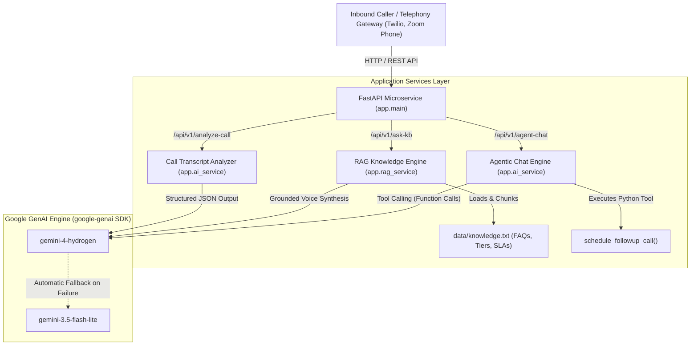

# AI CRM & Voice Agent Backend (Fortivex CRM API)

A clean, production-ready Python FastAPI microservice for an enterprise AI-powered CRM and Voice Agent platform (**Fortivex CRM**). Powered by the official Google GenAI SDK (`from google import genai`) using **`gemini-4-hydrogen`** (with automatic fallback to **`gemini-3.5-flash-lite`**).

---

## 🏗️ Architecture



### ASCII Architecture Diagram

```
+---------------------------------------------------------------------------------+
|                         INBOUND VOICE / TELEPHONY CLIENTS                      |
|                (Twilio Voice, Zoom Phone, Aircall, Webhooks, Web UI)            |
+---------------------------------------------------------------------------------+
                                       |
                                       v
+---------------------------------------------------------------------------------+
|                       FASTAPI MICROSERVICE (:8000)                              |
|                                                                                 |
|  [GET  /health]               System & Model Health Check                       |
|  [POST /api/v1/analyze-call]  Call Summarization, Sentiment & Lead Scoring      |
|  [POST /api/v1/ask-kb]        Voice RAG Knowledge Retrieval                     |
|  [POST /api/v1/agent-chat]    Agentic Function Calling for Booking Demos        |
+---------------------------------------------------------------------------------+
          |                               |                          |
          v                               v                          v
+-------------------+           +-------------------+      +--------------------+
|  Call Analyzer    |           |    RAG Engine     |      |  Agentic Tooling   |
| (Structured JSON) |           |  (Grounding KB)   |      | (Function Calling) |
+-------------------+           +-------------------+      +--------------------+
          |                               |                          |
          |                               v                          v
          |                     +-------------------+      +--------------------+
          |                     | data/knowledge.txt|      | schedule_followup_ |
          |                     |  (Fortivex Docs)  |      |  call() (Booking)  |
          |                     +-------------------+      +--------------------+
          \                               |                          /
           -------------------------------+--------------------------
                                          |
                                          v
                +---------------------------------------------------+
                |          GOOGLE GENAI SDK (google.genai)          |
                |                                                   |
                |   Primary:  gemini-4-hydrogen                     |
                |   Fallback: gemini-3.5-flash-lite                 |
                +---------------------------------------------------+
```

---

## 🌟 Key Features

1. **Call Transcript Analyzer (`POST /api/v1/analyze-call`)**:
   - Analyzes raw telephone audio transcripts between agents and prospects.
   - Generates structured JSON adhering to a strict Pydantic schema:
     - `summary`: Concise executive summary of customer needs.
     - `sentiment`: Customer sentiment (`Positive`, `Neutral`, `Negative`).
     - `lead_score`: Lead qualification rating from 1 to 10.
     - `recommended_action`: Actionable next steps for sales/CSM.
     - `key_pain_points`: Extracted pain points.
     - `followup_required`: Boolean urgency flag.

2. **Grounded Voice RAG (`POST /api/v1/ask-kb`)**:
   - Indexes and retrieves semantic chunks from `data/knowledge.txt` (Fortivex CRM pricing, tiers, features, SLAs).
   - Feeds context into Gemini with strict grounding system instructions to ensure **zero hallucination**.
   - Output formatted for realistic voice telephony: crisp, natural, 2–3 spoken sentences.

3. **Agentic Tool Calling (`POST /api/v1/agent-chat`)**:
   - Equips Gemini with the native Python function `schedule_followup_call(customer_name, preferred_time, topic)`.
   - When a caller requests a demo, callback, or appointment, Gemini autonomously triggers the tool.
   - Registers booking in the confirmed registry and returns the appointment reference ID and spoken confirmation.

4. **Resilient Model Failover**:
   - Queries `gemini-4-hydrogen` by default.
   - Automatically fails over to `gemini-3.5-flash-lite` if the primary model is unavailable or rate-limited.
   - Offline deterministic fallback mode allows all unit and integration tests to run with or without a live API key.

---

## 📁 Repository Structure

```
ai-crm-voice-agent-api/
│
├── .env.example              # Sample environment configuration
├── .env                      # Local environment configuration (ignored by git)
├── .gitignore                # Git ignore rules
├── Dockerfile                # Production multi-stage python:3.11-slim container
├── README.md                 # Complete documentation, architecture, and curl examples
├── requirements.txt          # Python dependencies
│
├── app/
│   ├── __init__.py           # Package marker
│   ├── config.py             # Settings loader and environment verification
│   ├── models.py             # Pydantic request/response and structured output schemas
│   ├── rag_service.py        # Knowledge base chunking, retrieval, and grounded Q&A
│   ├── ai_service.py         # Call transcript analyzer & agentic tool calling
│   └── main.py               # FastAPI microservice with REST endpoints
│
├── data/
│   └── knowledge.txt         # Realistic Fortivex CRM company FAQs, tiers & policies
│
└── tests/
    └── test_api.py           # Comprehensive pytest suite for all endpoints & tools
```

---

## 🚀 Quickstart & Local Setup

### Prerequisites
- Python 3.11+
- Git

### 1. Clone & Set Up Virtual Environment

```bash
# Clone the repository
git clone https://github.com/your-org/ai-crm-voice-agent-api.git
cd ai-crm-voice-agent-api

# Create a virtual environment
python -m venv .venv

# Activate the virtual environment
# On Linux/macOS:
source .venv/bin/activate
# On Windows (PowerShell):
.venv\Scripts\Activate.ps1
# On Windows (CMD):
.venv\Scripts\activate.bat
```

### 2. Install Dependencies

```bash
pip install --upgrade pip
pip install -r requirements.txt
```

### 3. Configure Environment Variables

Copy `.env.example` to `.env` and set your Gemini API key:

```bash
cp .env.example .env
```

Edit `.env`:
```env
GEMINI_API_KEY=your_actual_gemini_api_key_here
GEMINI_MODEL=gemini-4-hydrogen
GEMINI_FALLBACK_MODEL=gemini-3.5-flash-lite
APP_HOST=0.0.0.0
APP_PORT=8000
```

### 4. Run the API Server

```bash
uvicorn app.main:app --host 0.0.0.0 --port 8000 --reload
```

Interactive Swagger documentation will be available at:
👉 **http://localhost:8000/docs**
👉 **http://localhost:8000/redoc**

### 5. Run the Test Suite

```bash
pytest -v
```

---

## 🐳 Docker Deployment

### Build the Docker Image

```bash
docker build -t ai-crm-voice-agent-api:latest .
```

### Run the Container

```bash
docker run -d \
  --name crm-voice-agent \
  -p 8000:8000 \
  -e GEMINI_API_KEY="your_api_key_here" \
  ai-crm-voice-agent-api:latest
```

Verify container health:
```bash
docker ps
curl http://localhost:8000/health
```

---

## 📡 Sample cURL Commands

### 1. Health Check
```bash
curl -X GET "http://localhost:8000/health" \
  -H "Accept: application/json"
```

**Sample Response:**
```json
{
  "status": "healthy",
  "service": "ai-crm-voice-agent-api",
  "version": "1.0.0",
  "primary_model": "gemini-4-hydrogen",
  "fallback_model": "gemini-3.5-flash-lite",
  "api_key_configured": true
}
```

---

### 2. Analyze Call Transcript
Extracts summary, customer sentiment, lead score (1–10), and recommended action:

```bash
curl -X POST "http://localhost:8000/api/v1/analyze-call" \
  -H "Content-Type: application/json" \
  -d '{
    "transcript": "Agent: Thanks for calling Fortivex CRM. My name is Alex.\nCustomer: Hi Alex, I am Sarah, VP of Sales at TechNova. We have 45 reps using HubSpot, but our team hates manually typing call summaries. We need an AI voice agent that transcribes calls, scores leads, and logs summaries directly to our CRM. If this works, we want to roll it out to all reps next month. Could we schedule a demo tomorrow at 2 PM?"
  }'
```

**Sample Response:**
```json
{
  "summary": "Sarah, VP of Sales at TechNova with 45 sales reps, is seeking an automated AI voice solution to eliminate manual call summaries and sync lead scores directly to HubSpot.",
  "sentiment": "Positive",
  "lead_score": 9,
  "recommended_action": "Schedule an immediate executive demo for 45 seats and prepare HubSpot CRM integration architecture overview.",
  "key_pain_points": [
    "Manual call logging friction",
    "Lack of automated lead scoring",
    "HubSpot bi-directional sync requirement"
  ],
  "followup_required": true,
  "model_used": "gemini-4-hydrogen"
}
```

---

### 3. Ask Knowledge Base (RAG)
Asks a question grounded strictly in `data/knowledge.txt`:

```bash
curl -X POST "http://localhost:8000/api/v1/ask-kb" \
  -H "Content-Type: application/json" \
  -d '{
    "question": "What is included in the Growth tier and what is the overage fee for voice minutes?"
  }'
```

**Sample Response:**
```json
{
  "question": "What is included in the Growth tier and what is the overage fee for voice minutes?",
  "answer": "The Fortivex Growth plan is priced at $99 per user per month and includes 2,500 AI voice minutes, real-time agentic function calling, advanced lead scoring, bi-directional CRM sync, and telephony connectors. Any additional voice minutes beyond the included amount are billed at $0.03 per minute.",
  "sources": [
    "3. PRICING TIERS & PLANS",
    "GROWTH PLAN (Most Popular)"
  ],
  "model_used": "gemini-4-hydrogen"
}
```

---

### 4. Agentic Voice Chat (Tool Calling)
Sends a message where the customer requests an appointment or demo. Gemini automatically triggers `schedule_followup_call`:

```bash
curl -X POST "http://localhost:8000/api/v1/agent-chat" \
  -H "Content-Type: application/json" \
  -d '{
    "message": "Hi, my name is Michael Scott. I would like to schedule a product demo tomorrow at 3 PM to review Enterprise HIPAA compliance.",
    "customer_name": "Michael Scott"
  }'
```

**Sample Response:**
```json
{
  "reply": "I have scheduled your product demo for Michael Scott tomorrow at 3:00 PM EST regarding Enterprise HIPAA compliance. A calendar invitation has been sent to your team. Booking reference: BK-A8E29C10.",
  "tool_called": true,
  "tool_execution": {
    "tool_name": "schedule_followup_call",
    "tool_args": {
      "customer_name": "Michael Scott",
      "preferred_time": "Tomorrow at 3 PM",
      "topic": "Enterprise HIPAA compliance"
    },
    "tool_result": {
      "status": "confirmed",
      "booking_id": "BK-A8E29C10",
      "customer_name": "Michael Scott",
      "preferred_time": "Tomorrow at 3 PM",
      "topic": "Enterprise HIPAA compliance",
      "calendar_event_created": true,
      "confirmation_message": "Follow-up call confirmed for Michael Scott on Tomorrow at 3 PM regarding 'Enterprise HIPAA compliance'. Reference ID: BK-A8E29C10."
    }
  },
  "model_used": "gemini-4-hydrogen"
}
```

---

## 🔒 Security & Best Practices

- **Zero-Storage of API Keys**: Secrets are loaded strictly via environment variables.
- **Strict Pydantic Validation**: Input data is validated at API boundaries.
- **Non-Root Container Execution**: The Docker container runs under `appuser` (UID 1001).
- **Graceful Error Handling**: Unified HTTP error responses prevent leaking raw internal stack traces.

---

## 📄 License
MIT License. Open-source and free for commercial and enterprise use.
